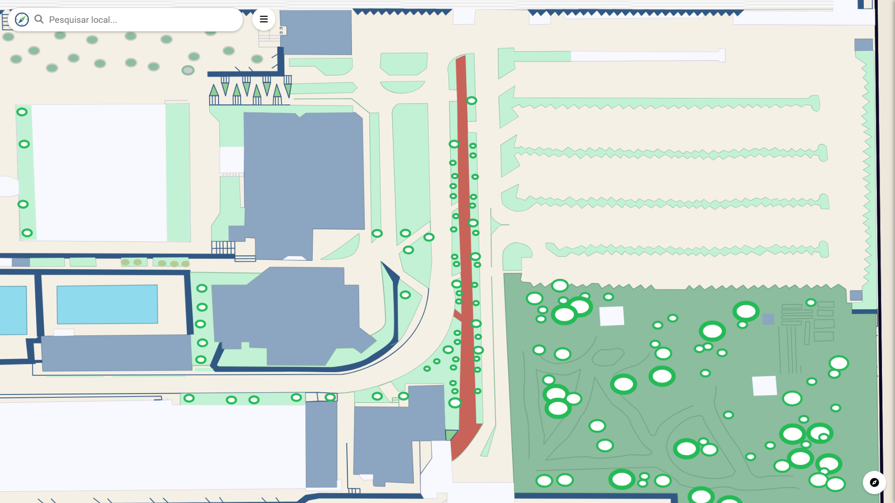
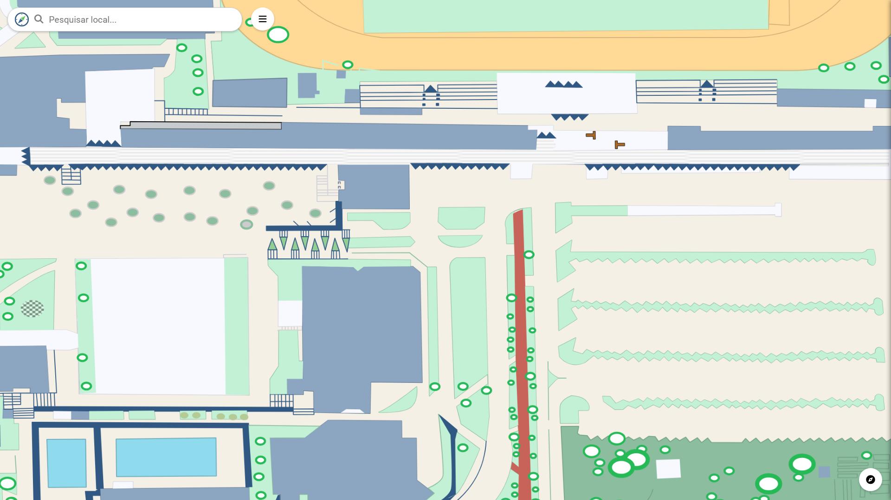

# CDU001. Uso do Mapa

- **Ator principal**: Usuário qualquer
- **Atores secundários**: Nenhum
- **Resumo**: O usuário desloca-se para uma nova região do mapa
- **Pré-condição**: Usuário está na tela inicial da aplicação
- **Pós-Condição**: Usuário é deslocado para uma nova visão de locais no mapa

## Fluxo Principal

1. Usuário
   1. desliza pela tela do mapa
      
      
2. Sistema
   1. Muda a tela do usuário para uma nova região do mapa
      - Javascript obtêm as coordenadas do ponto de toque na tela e processa o objeto em colisão com o toque.
   2. Busca as informações do local selecionado
      - O django retorna ao javascript os dados do local selecionado.
   3. Expôe os dados de informações, imagens e descrições para o usuário visualmente.
      