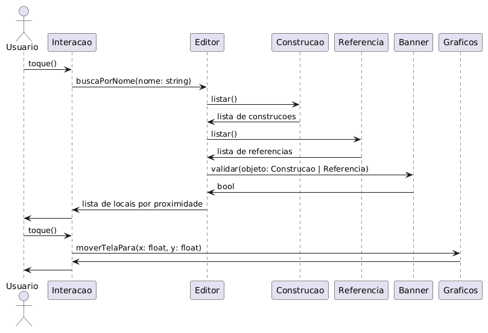
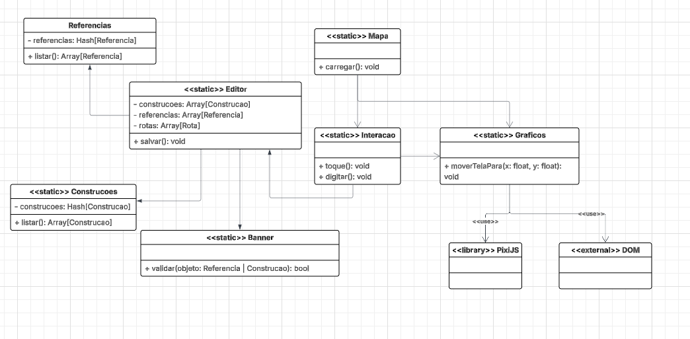

# CDU0013. Pesquisar Local

- **Ator principal**: Usuário qualquer
- **Atores secundários**: Nenhum
- **Resumo**: Utiliza a barra de pesquisa para encontrar um lugar
- **Pré-condição**: Usuário está na tela de interação com o mapa
- **Pós-Condição**: Usuário é redirecionado ao local com o banner informativo aberto

## Fluxo Principal
| Ações do ator | Ações do sistema |
| :-----------------: | :-----------------: | 
| 1.1 - Usuário aperta na barra de pesquisa | |  
| 1.2 - Usuário digita um texto | |  
| | 2.1 - Realiza uma busca entre locais referenciais | 
| | 2.2 - Expôe os resultado mais similares | 
| 3 - Seleciona uma das opções apresentadas | | 
| | 4 - Redireciona o usuário no mapa e abre o banner para o respectivo local |

## Fluxo de Exceção - Local Não Encontrado na Busca
| Ações do ator | Ações do sistema |
| :-----------------: | :-----------------: | 
| 1.1 - Usuário aperta na barra de pesquisa | |  
| 1.2 - Usuário digita um texto | |  
| | 2.1 - Realiza uma busca entre locais referenciais | 
| | 2.2 - Expôe que não há resultados para essa busca |

> Obs. as seções a seguir apenas serão utilizadas na segunda unidade do PDSWeb (segundo orientações do gerente do projeto).

## Diagrama de Sequência

## Diagrama de Classes de Projeto

