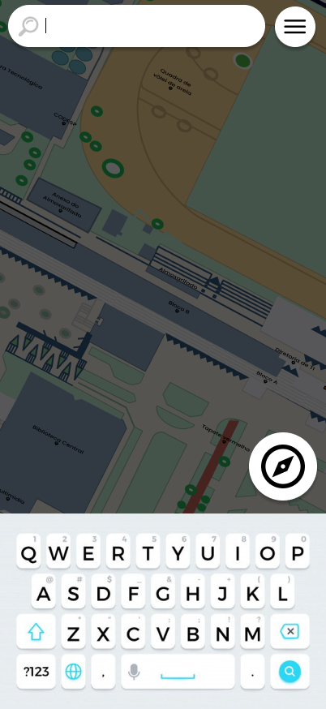

# CDU0013. Pesquisar Local

- **Ator principal**: Usuário qualquer
- **Atores secundários**: Nenhum
- **Resumo**: Utiliza a barra de pesquisa para encontrar um lugar
- **Pré-condição**: Usuário está na tela de interação com o mapa
- **Pós-Condição**: Usuário é informado que não há resultados para a busca

| Ações do ator | Ações do sistema |
| :-----------------: | :-----------------: | 
| 1.1 - Usuário aperta na barra de pesquisa | |  
| 1.2 - Usuário digita um texto | |  
| | 2.1 - Realiza uma busca entre locais referenciais | 
| | 2.2 - Expôe que não há resultados para essa busca |

## Fluxo de Exceção - Local Não Encontrado na Busca
1. Usuário
    1. Usuário aperta na barra de pesquisa
        
    2. Usuário digita um texto
        - Usuário usa o teclado para digitar o local de destino que busca.
2. Sistema
    1. Realiza uma busca entre locais referenciais
        - Javascript realiza uma simples busca de similaridade entre o texto e as contruções e referências disponíveis.
    2. Expôe que não há resultados para essa busca
        - Resultado da busca mostra apenas o texto "Nenhum resultado".