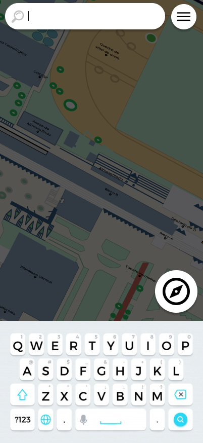
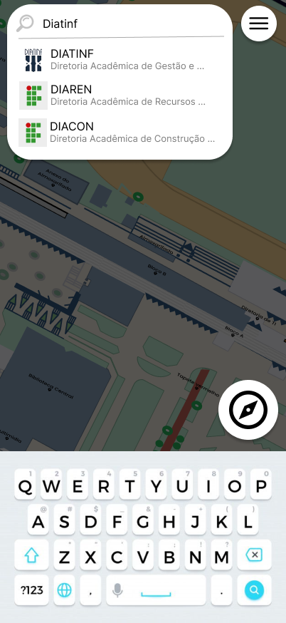
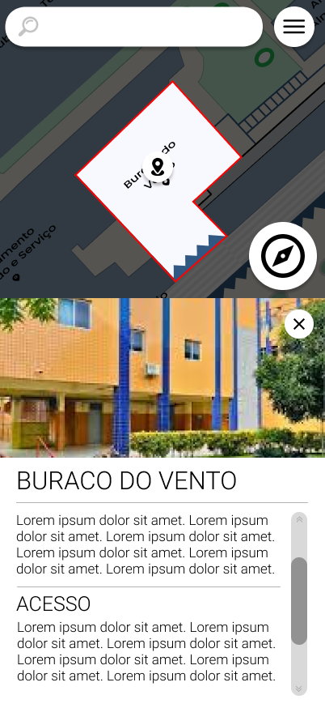

# CDU0013. Pesquisar Local

- **Ator principal**: Usuário qualquer
- **Atores secundários**: Nenhum
- **Resumo**: Utiliza a barra de pesquisa para encontrar um lugar
- **Pré-condição**: Usuário está na tela de interação com o mapa
- **Pós-Condição**: Usuário é redirecionado ao local com o banner informativo aberto

## Fluxo Principal

1. Usuário
   1. Usuário aperta na barra de pesquisa
      
   2. Usuário digita um texto
      - Usuário usa o teclado para digitar o local de destino que busca.
2. Sistema
   1. Realiza uma busca entre locais referenciais
      - Javascript realiza uma simples busca de similaridade entre o texto e as contruções e referências disponíveis.
   2. Expôe os resultado mais similares 
      
3. Usuario
   1. Seleciona uma das opções apresentadas
      - Usuário aperta em uma das opções mostradas pelo javascript
4. Sistema
   1. Redireciona o usuário no mapa e abre o banner para o respectivo 
      